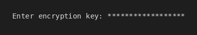
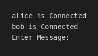
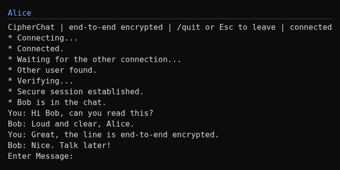
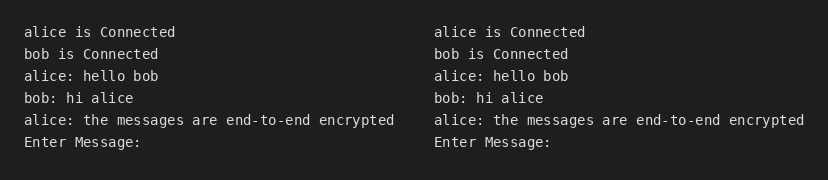

# CipherChat

CipherChat is a secure and encrypted chat application implemented in C#. 
It consists of a console-based client and server, utilizing AES-256-GCM encryption 
for secure communication between users.

## Features

- End-to-end authenticated encryption using AES-256-GCM.
- Multi-user chat functionality with real-time message broadcasting.
- Password-protected encryption keys.
- All users connect using a shared pre-defined encryption key for secure communication.

## Screenshots

| Login | Connected | Chat |
|---|---|---|
|  |  |  |

Two clients in the same conversation:



## Getting Started

Follow these instructions to set up and run CipherChat on your system.

### Prerequisites

- .NET SDK 6.0 or later

### Installation

1. Clone this repository:
   ```bash
   git clone https://github.com/ChrisLPJones/CipherChat.git
   cd CipherChat
   ```

2. Build the project using the .NET CLI:
   ```bash
   dotnet build
   ```

### Running the Server

1. Navigate to the server directory:
   ```bash
   cd CipherChatServer
   ```

2. Run the server:
   ```bash
   dotnet run
   ```

### Running the Client

1. Navigate to the client directory:
   ```bash
   cd CipherChatClient
   ```

2. Run the client:
   ```bash
   dotnet run
   ```

3. Enter your username and the shared encryption key to connect.

## How It Works: Secure Communication

CipherChat ensures secure communication between all connected users by employing AES-256-GCM authenticated encryption. 
Below are the detailed steps emphasizing the encryption process:

1. **Pre-defined Encryption Key**:
   - All users must agree on and use the same pre-defined encryption key.
   - This key is required to encrypt and decrypt messages exchanged in the chat.
   - Without the correct key, users cannot participate in the chat or interpret the messages.

2. **Key Derivation**:
   - CipherChat derives a 256-bit AES key from the passphrase (shared encryption key) and a randomly generated salt.
   - This derivation is performed using PBKDF2 (Password-Based Key Derivation Function 2) with 600,000 iterations and SHA256 as the hash algorithm.
   - The derived key ensures that even if the passphrase is weak, the encryption remains secure due to the computational complexity of the key derivation process.

3. **Connecting to the Server**:
   - When a user connects, they must enter their username and the shared encryption key.
   - The client uses this encryption key to encrypt a connection notification, which is sent to the server.
   - The server uses this encrypted message to verify the connection and broadcast the notification to other clients.

4. **Sending Messages**:
   - Users type their messages in the console input line and press `Enter` to send.
   - Before the message is sent, it is encrypted on the client-side using AES-256-GCM with the derived key and a random per-message salt and nonce.
   - The encrypted message is sent to the server, ensuring that no sensitive information is transmitted in plaintext.

5. **Server Broadcasting**:
   - The server receives the encrypted message from the client.
   - Without decrypting it, the server broadcasts the encrypted message to all connected clients.
   - This ensures that the server does not have access to the actual message content, maintaining end-to-end encryption.

6. **Message Decryption**:
   - Each client receives the encrypted message from the server.
   - The client uses the shared encryption key and derived AES key to decrypt the message locally. GCM authenticates every message, so a wrong key or tampered data is detected and reported ("the shared key is probably wrong") instead of being dropped silently. A lone user has nobody to compare against, so a wrong key only shows up once another user is present.
   - Once decrypted, the message is displayed in the chat interface for the user to read.

By adhering to this process, CipherChat ensures that all communication remains secure, private, and accessible only to users with the correct pre-defined encryption key.

## Protocol change (v2)

Messages are now AES-256-GCM, Base64 of `version(0x02) | salt(16) | nonce(12) | ciphertext | tag(16)`, one per
newline-delimited line. Old (AES-CBC) and new clients cannot read each other: upgrade all clients together.
Limits (`ProtocolLimits`): usernames 1-20 characters of `A-Za-z0-9_.-`, messages up to 2000 characters, lines up to
11000 characters. The server drops and disconnects clients that send over-length or non-Base64 lines.

## Trust model

- Transport is plain TCP: no TLS. Only message payloads are encrypted client-side; framing, line lengths, timing, IP addresses and connection times are visible to anyone on the path. TLS is a deliberate, documented-only decision for now.
- The server never holds the key and cannot read messages or usernames (inside the ciphertext). It sees ciphertext, sizes, timing, who is connected (as opaque encrypted entries) and IP addresses.
- The server prints every relayed ciphertext (and the user list) to its console; treat server logs as sensitive metadata. Plaintext is never logged.
- Anyone who can reach the port can connect and relay, inject, drop or replay lines. AES-GCM stops them reading or forging messages without the key, but not replay, dropping or flooding. Any holder of the shared key can claim any username (no sender authentication).
- The shared key is the single secret; a leaked or weak key exposes all past and future traffic (PBKDF2 slows guessing, it does not prevent it). Use a long random passphrase. Run on loopback/LAN or inside a VPN/SSH tunnel.

## Contributing

Contributions are welcome! Please fork the repository and submit a pull request.

## License

This project is licensed under the MIT License. See the LICENSE file for details.
